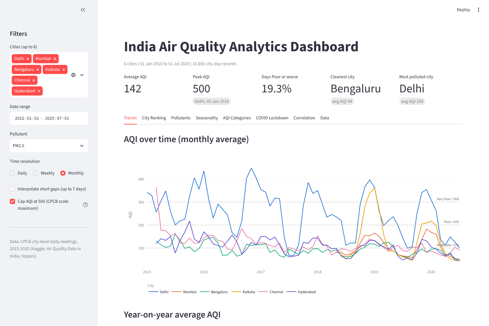
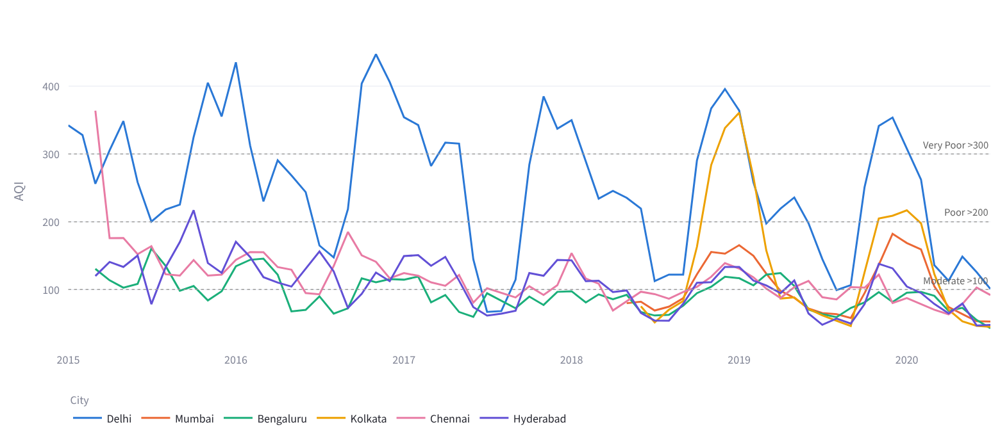
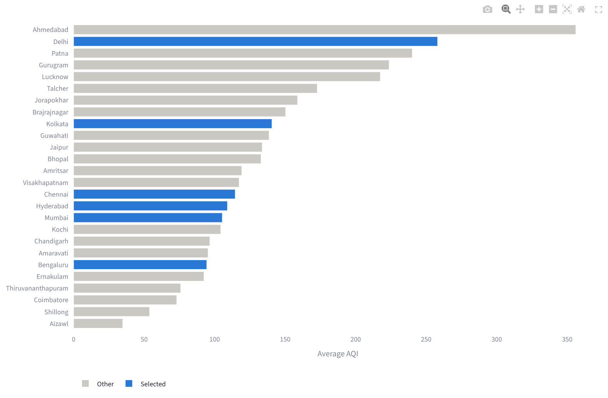
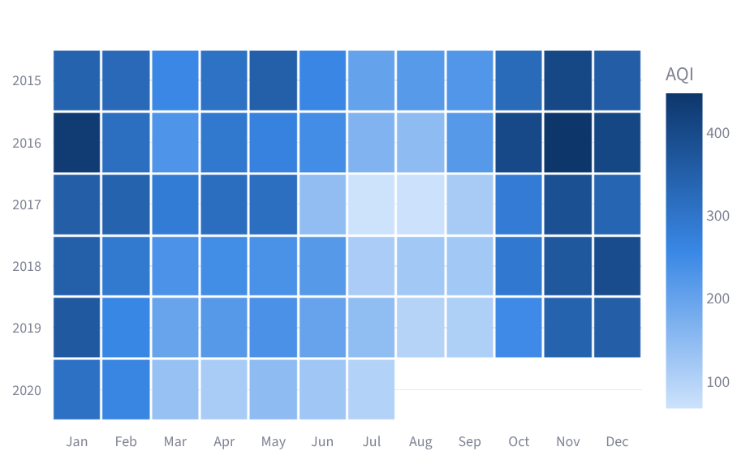
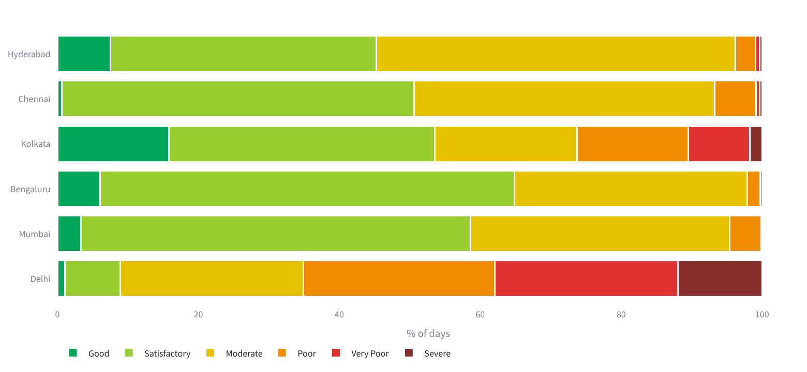
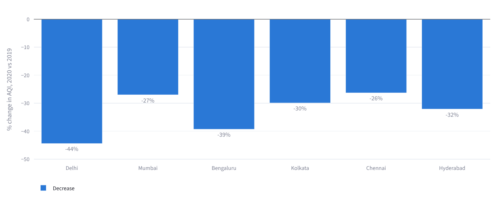
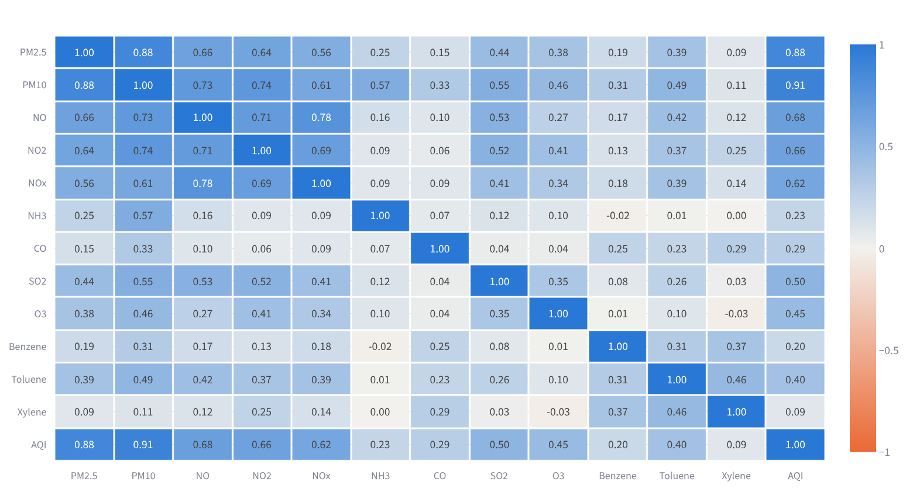

# India Air Quality Analytics Dashboard (2015-2020)

An interactive dashboard for exploring daily air quality across 26 Indian cities, built with open source tools: Python, pandas, Streamlit and Plotly.

Mini project for the Data Analytics course (CSD40070), M.Tech Data Science and Analytics, MIT World Peace University, Pune.



## Features

- Sidebar filters: cities (compare up to 6), date range, pollutant, time resolution (daily, weekly, monthly)
- Optional linear interpolation of short data gaps (up to 7 days, within each city)
- Optional cap of AQI at 500, the maximum of the CPCB scale
- KPI row: average AQI, peak AQI, share of days Poor or worse, cleanest and most polluted city
- Eight analysis tabs:

| Tab | What it shows |
|---|---|
| Trends | AQI over time per city, year-on-year averages |
| City Ranking | Average AQI for all 26 cities, selected cities highlighted |
| Pollutants | Pollutant trend, daily distribution (box plot), average pollutant profile |
| Seasonality | Year-by-month AQI heatmap, average AQI by season |
| AQI Categories | Share of days in each CPCB category, in official CPCB colours |
| COVID Lockdown | % change in AQI and pollutants, 25 Mar - 31 May 2020 vs 2019 |
| Correlation | Pearson correlation matrix of pollutants and AQI |
| Data | Filtered records, CSV download, missing values, summary statistics |

## Dataset

[Air Quality Data in India (2015-2020)](https://www.kaggle.com/datasets/rohanrao/air-quality-data-in-india) by Vopani (Rohan Rao), compiled from the Central Pollution Control Board (CPCB). This project uses the city-level daily file `city_day.csv`.

| Property | Value |
|---|---|
| Records | 29,531 city-day rows |
| Cities | 26 |
| Period | 1 Jan 2015 to 1 Jul 2020 |
| Columns | City, Date, PM2.5, PM10, NO, NO2, NOx, NH3, CO, SO2, O3, Benzene, Toluene, Xylene, AQI, AQI_Bucket |

## Getting started

Requires Python 3.9 or later.

```
git clone https://github.com/VighneshKunjir/india-aqi-dashboard.git
cd india-aqi-dashboard
pip install -r requirements.txt
streamlit run app.py
```

The dashboard opens at http://localhost:8501.

## Project structure

```
india-aqi-dashboard/
|-- app.py              Streamlit dashboard: filters, KPIs, charts
|-- data_prep.py        Loading, cleaning, feature engineering
|-- requirements.txt    Python dependencies
|-- data/
|   `-- city_day.csv    CPCB dataset
`-- screenshots/        Chart images
```

## Data processing

1. Parse dates, drop duplicate city-date rows, set negative values to missing
2. Fill missing `AQI_Bucket` from `AQI` using CPCB ranges
3. Derive Year, Month and Season (Winter: Dec-Feb, Summer: Mar-May, Monsoon: Jun-Sep, Post-monsoon: Oct-Nov)
4. Filter by the sidebar selections, then aggregate with `groupby` and `resample`

Missing values are not filled by default; pandas means skip them, so averages use only real readings.

## Key findings

- Highest average AQI: Ahmedabad (356), Delhi (258), Patna (240), Gurugram (224), Lucknow (217). Lowest: Aizawl (35), Shillong (54), Coimbatore (73).
- Delhi was Poor, Very Poor or Severe on 65% of days. Its worst months are November to January; the cleanest are July and August.
- PM10 (r = 0.91) and PM2.5 (r = 0.88) are the pollutants most correlated with AQI in the six metros.
- During the 2020 lockdown, AQI in the six metros fell 26-44% compared with the same dates in 2019, and NO2 fell 28-65%.

## Screenshots

| | |
|---|---|
|  |  |
|  |  |
|  |  |

## Limitations

- Several pollutants are missing for 15-61% of days, and some cities start reporting years after 2015.
- 543 AQI readings exceed 500 (412 from Ahmedabad), suggesting sensor or reporting issues.
- No weather data, so the lockdown comparison cannot fully separate reduced activity from weather effects.

## Tech stack

Python, pandas, NumPy, Streamlit, Plotly
